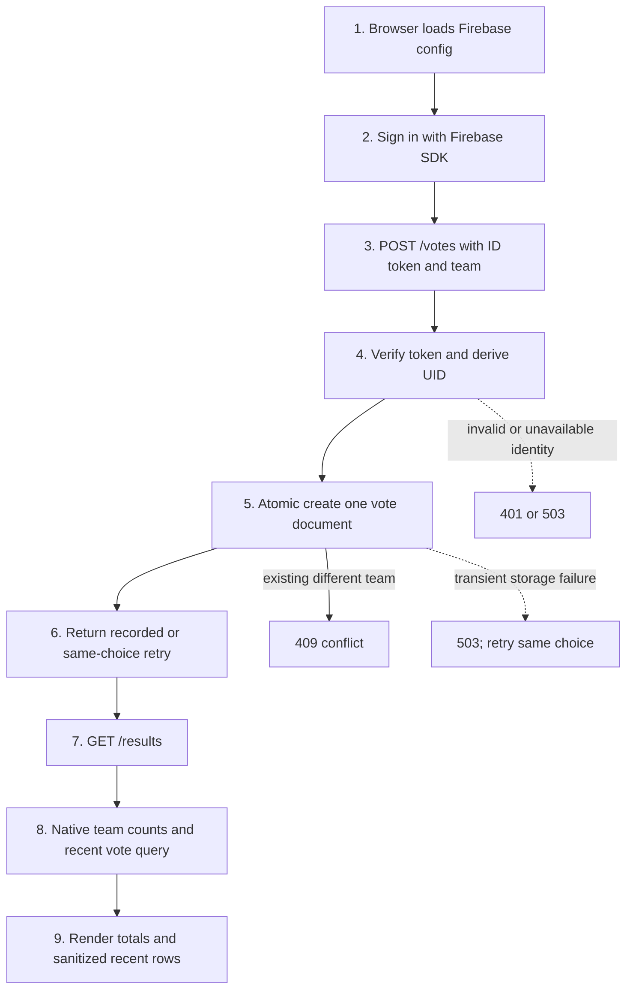
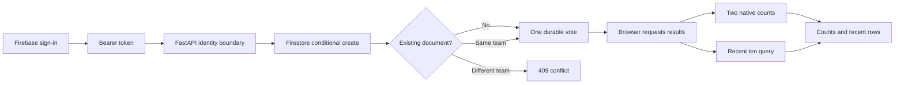
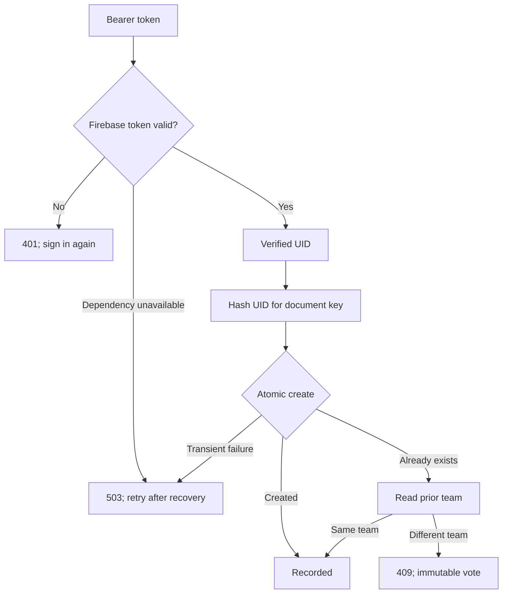
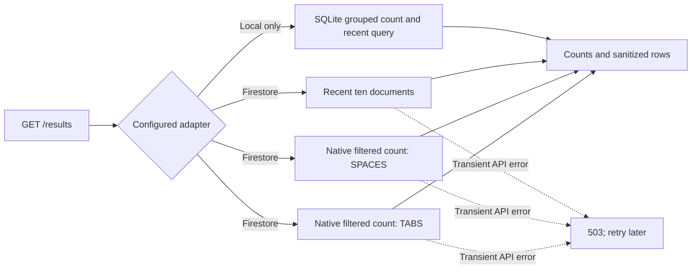

# Firestore voting app

A small FastAPI voting service inspired by the University of Pittsburgh CS 1660 [Cloud Run assignment](https://github.com/pitt-cs-1660/spring2025-cs1660-cloud-run-cc-cloud-run). It asks a signed-in user to choose tabs or spaces and presents totals and recent votes. This is an independent implementation, not a copied student submission. The course's [backend](https://github.com/pitt-cs-1660/spring2025-cs1660-cloud-run-cc-cloud-run/blob/main/docs/python-backend.md), [client](https://github.com/pitt-cs-1660/spring2025-cs1660-cloud-run-cc-cloud-run/blob/main/docs/client-side-js.md), and [identity](https://github.com/pitt-cs-1660/spring2025-cs1660-cloud-run-cc-cloud-run/blob/main/docs/oauth2.md) guides supplied the problem context. Unlike the starter, the API accepts JSON at `/votes` and does not offer an `auth=false` bypass.



## Run locally

Install Python 3.11 and create a project-local environment:

```powershell
python -m venv .venv
.venv/Scripts/python -m pip install -r requirements.txt
.venv/Scripts/python -m pytest -q
.venv/Scripts/python verify.py
```

The verification driver owns its local server and temporary SQLite database, checks 100 votes over HTTP, and retains `evidence/http-proof.json` and its SHA-256 after cleanup. The [verification skill](.agents/skills/verify-firestore-voting-app/SKILL.md) documents launch, doctor, drive, evidence, and cleanup. The driver uses **synthetic local identity** and SQLite, neither of which proves Google token verification or Firestore behavior.

To manually use the local API, set `APP_ENV=local`, `VOTING_BACKEND=sqlite`, `IDENTITY_MODE=local`, and `SQLITE_PATH` to a disposable database, then run `uvicorn app:app`. Send `Authorization: Bearer local:alice` and `{"team":"TABS"}` to `POST /votes`. This identity mode is deliberately unavailable in production. The browser uses real Firebase authentication, so it requires configured Firebase even when testing the API locally.

For actual Google integration, use a separately authorized Google Cloud project with Firestore and Identity Platform configured, Google sign-in enabled, and the deployment domain authorized. Supply `GOOGLE_CLOUD_PROJECT`, `FIREBASE_API_KEY`, and `FIREBASE_AUTH_DOMAIN` and application-default credentials with appropriate Firestore and Firebase privileges. Production is the default; it rejects local adapters and emulator environment variables. The web configuration values are public client configuration, not service-account secrets. Do not put credentials in this repository. The Dockerfile listens on Cloud Run's `PORT`; no cloud resources were created or deployed here.

## Request flow

1. The browser signs in with the Firebase SDK and sends its token; see [identity boundary](#identity-boundary).
2. FastAPI validates the choice and derives a verified UID, then performs [conditional creation](#conditional-creation-and-idempotency).
3. Firestore creates the vote once, or identifies a duplicate/conflict.
4. The browser refreshes the [public read model](#public-read-model); error paths are described in [recovery](#recovery).

### Identity boundary

The browser uses the Firebase SDK, while the backend calls `verify_id_token(..., check_revoked=True)` and derives UID only from its return value. This avoids trusting a caller-supplied UID. Revocation checking needs a network call and appropriate credentials; an outage returns 503 rather than accepting a token. SDK contract tests cover invalid, expired, revoked and disabled identities and certificate-fetch failures, but they stub the SDK and do not prove real credentials. An application session cookie could reduce repeated token handling, but adds cookie and CSRF lifecycle concerns. See [Google's ID-token verification](https://firebase.google.com/docs/auth/admin/verify-id-tokens) and [revocation](https://firebase.google.com/docs/auth/admin/manage-sessions) documentation.

### Conditional creation and idempotency

The `votes` document ID is a SHA-256 hash of UID. The SDK's atomic `create` succeeds only if that document does not exist. When it already exists, the server reads its team: a same-team retry succeeds and a different team conflicts. One document is the entire durable vote; no counter needs a second write. The hash is pseudonymous, not anonymous. Transient SDK timeouts, unavailable service, aborted operations and exhausted SDK retries return a retryable 503; callers can retry the same choice. An ambiguous timeout may follow a committed write, and the conditional create makes that retry safe. This assumes votes are immutable and not externally deleted between the create failure and read. See the [SDK create contract](https://docs.cloud.google.com/python/docs/reference/firestore/latest/google.cloud.firestore_v1.document.DocumentReference#create).

### Public read model

Each team count is a native filtered Firestore count query; recent rows contain only team and timestamp. Neither UID nor token is returned. The two count queries and recent list are separate reads, so they do not share a snapshot under concurrent writes. Count queries scan index entries and incur read charges that grow with matching entries; an aggregate counter has cheaper constant-size reads but adds a shared write hotspot and consistency work. A materialized reporting pipeline could improve read scaling at the cost of freshness and operational complexity. See [count aggregations](https://docs.cloud.google.com/firestore/native/docs/query-data/aggregation-queries) and [Firestore pricing](https://cloud.google.com/firestore/pricing). Timestamps can reveal participation patterns.

### Recovery

Missing, invalid, expired, revoked or disabled credentials return 401; reauthenticate. Bad choice returns 422; send `TABS` or `SPACES`. A different existing vote returns 409; the application does not support changing a vote. Identity verification outages and recognized transient storage failures return 503; retry the same choice after the dependency recovers. Other storage failures return server errors and should be investigated before retrying. `/health` checks process readiness only, not external service availability.

## Design and tradeoffs

### Resume review map

The browser and backend are connected by HTTP requests. A vote write finishes before the browser asks for results; there is no shared-counter transaction. Firestore stores each immutable vote as one UID-keyed document, and reads use two native count queries plus a separate recent-vote query.



| Step | Handoff and technique | Exact implementation |
| --- | --- | --- |
| <a id="flow-step-config"></a>1. Configure browser | Public Firebase web configuration; missing config disables sign-in | [config and settings](app.py#L23), [browser bootstrap](static/app.js#L4) |
| <a id="flow-step-auth"></a>2. Sign in | Firebase popup sets current browser user | [sign-in handler](static/app.js#L19) |
| <a id="flow-step-submit"></a>3. Submit team | Browser obtains an ID token and posts the selected team | [vote handler](static/app.js#L40), [Vote route](app.py#L141) |
| <a id="flow-step-identity"></a>4. Establish identity | Backend verifies token including revocation, then uses returned UID | [user_id](app.py#L58) |
| <a id="flow-step-create"></a>5. Store vote | SHA-256 UID document ID and Firestore atomic `create` | [key and FirestoreStore.cast](app.py#L74), [FirestoreStore.cast](app.py#L100) |
| <a id="flow-step-idempotent"></a>6. Retry same choice | Existing document is read; matching team is accepted | [FirestoreStore.cast](app.py#L100), [vote route](app.py#L141) |
| <a id="flow-step-conflict"></a>7. Reject changed vote | Different existing team maps to HTTP 409 | [vote route](app.py#L141) |
| <a id="flow-step-read"></a>8. Read state | Browser refresh calls results after successful submission | [browser refresh](static/app.js#L24), [results route](app.py#L133) |
| <a id="flow-step-counts"></a>9. Count and list | Two filtered native count aggregations and a separately read recent list | [FirestoreStore.results](app.py#L112) |
| <a id="flow-step-render"></a>10. Render | Counts and recent team/time values update the page | [render results](static/app.js#L24) |

<details><summary>Technique: conditional create for idempotent votes</summary>

**How:** `FirestoreStore.cast` creates the hashed UID document. `AlreadyExists` triggers a read; a matching team returns success, while another team returns false and the route responds 409.

**Why:** one immutable document makes the same request safe to retry without maintaining a second shared counter write.

**Alternative and tradeoff:** a transaction-maintained counter was tried historically and its contention failures remain in the evidence below. Current code uses Firestore atomic document creation and native count queries. The hash is pseudonymous, and a timeout can occur after commit; retrying the same choice resolves that ambiguity.
</details>

<details><summary>Technique: native count queries for the read model</summary>

**How:** `FirestoreStore.results` filters by team and calls Firestore's count aggregation twice, then independently streams the ten newest documents.

**Why:** stored vote documents remain the source of truth and no shared hot counter is written on each vote.

**Alternative and tradeoff:** materialized counters can reduce read work but require extra consistency and contention handling. Native counts scan matching index entries; separate reads do not share a point-in-time snapshot.
</details>

<details><summary>Technique: identity and transient-failure recovery</summary>

**How:** Firebase Admin validates the bearer token and revocation before yielding UID. Invalid credentials return 401; verification dependency failures return 503. Recognized transient Firestore errors return 503, and the browser displays the outcome.

**Why:** caller-supplied identity is not trusted, and availability failures do not become false success.

**Alternative and tradeoff:** local synthetic identity and SQLite support isolated development, but settings reject them outside `APP_ENV=local`; their checks do not prove Firebase or Firestore cloud behavior.
</details>

### Subsystem: identity and storage recovery



### Subsystem: result reads and local boundary



<details><summary>Technique: SQLite adapter for local HTTP exercises</summary>

**How:** `SQLiteStore` writes one unique hashed UID row in a transaction and computes grouped counts plus recent rows.

**Why:** the verification driver can exercise API behavior without paid cloud resources.

**Alternative and tradeoff:** Firestore is the production adapter. SQLite is process-local file storage and cannot establish Firestore consistency, IAM, or token-verification behavior.
</details>

<a id="technique-create"></a><a id="technique-native-counts"></a><a id="technique-recovery"></a><a id="technique-local-adapter"></a>

| Technique | Why | Alternative and limit |
| --- | --- | --- |
| Firebase Admin token verification, including revocation | Obtain the UID from the server-verified token, never from the request body | Live verification depends on Firebase and credentials; SDK boundary tests stub it and are not live authentication. |
| One document keyed by SHA-256 of UID | Retry the same choice without duplicating a vote; a different choice returns 409 | A hash is pseudonymous, not anonymous if a UID is known. No vote changes or deletion are implemented. |
| Conditional Firestore create and native count | One immutable vote is the source of truth, avoiding shared counter writes | Count reads scale with indexed entries, and separately executed counts can observe different moments. |
| Recent response contains only team and timestamp | Avoid exposing UIDs, tokens, and profile information | Timestamps can still reveal participation patterns. Recent rows and counts are separate reads. |
| SQLite local adapter | Exercise real HTTP and durable state without paid cloud resources | It is not a Firestore emulator and cannot verify Google SDK behavior. |

The course template was rendered locally and visually compared with this implementation in Chrome; [design notes](.agents/design-reference.md) record the viewport, sources, and departures. Real browser login and a narrow screenshot remain unverified.

## Evidence and limits

The local driver uses HTTPX and five sequential batches of 20 requests, checks every HTTP status, aggregate after each batch, and independently checks 100 SQLite rows. `benchmark.py` additionally records five batches at each of concurrency 1 and 4; each of ten unique users submits a vote, repeats it and submits a conflicting choice. Every status, latency in milliseconds, error, aggregate, durable row count, platform and source hash is retained in `evidence/http-concurrency.json`. These are local functional timing samples, not a cloud load or throughput claim.

The official Firestore emulator (Firebase CLI 14.22.0, emulator 1.19.8, Java 21, demo project and loopback) exercised atomic create and native count with eight workers. Sixteen competing choices for one UID and 40 distinct UIDs produced 41 exact documents, matching counts of 20 and 21, and zero reported request errors; see `evidence/emulator-create-count.log`. The earlier transaction-plus-counter approach hit lock timeouts in the same emulator, including seven exhausted retries among 12 distinct calls in a two-worker run; its failed and final receipts remain in `evidence/emulator-attempts.md` and `evidence/emulator-final.log`. Workloads differ and emulator timing is not a production performance comparison. Real Google identity, IAM, Cloud Run, and live Firestore remain unverified.

To run the emulator test locally, install Firebase CLI separately in an isolated tool directory, then run `.tools/node_modules/.bin/firebase.cmd emulators:exec --project demo-voting --only firestore '.venv\Scripts\python.exe -m pytest -q -s tests/test_firestore_emulator.py'` on Windows. The configuration binds Firestore to loopback on port 18880; it uses a demo project and the CLI stops its owned emulator after the command. The emulator allows reads/writes by default; it does not verify production security rules or IAM.

## Glossary and interview walkthrough

An **ID token** is the Firebase-issued credential presented by the browser. A **UID** identifies the authenticated account. A **conditional create** writes only if the document does not exist. An **idempotent** retry repeats an operation without adding a second vote. A **hotspot** is a shared record that limits concurrent writes.

Walk through a request: the browser gets a token; the API verifies it and hashes the UID; Firestore atomically creates one vote document. If it already exists, a read decides whether the retry matches or conflicts. Result counts query the durable vote documents. Emulator tests exercise those SDK calls; live Firestore requires separate evidence.

Potential resume bullets (scope to actual verified work):

- Built a FastAPI voting API with Firebase Admin token verification, UID-keyed conditional Firestore writes, and native count queries.
- Developed a local HTTP verification driver and concurrency tests for idempotent voting, with five recorded request batches and durable SQLite row-count checks.

Primary references: [Firestore create](https://docs.cloud.google.com/python/docs/reference/firestore/latest/google.cloud.firestore_v1.document.DocumentReference#create), [Firestore aggregations](https://docs.cloud.google.com/firestore/native/docs/query-data/aggregation-queries), [Firebase ID token verification](https://firebase.google.com/docs/auth/admin/verify-id-tokens), [Firebase session revocation](https://firebase.google.com/docs/auth/admin/manage-sessions), and [Cloud Run container contract](https://cloud.google.com/run/docs/container-contract).
